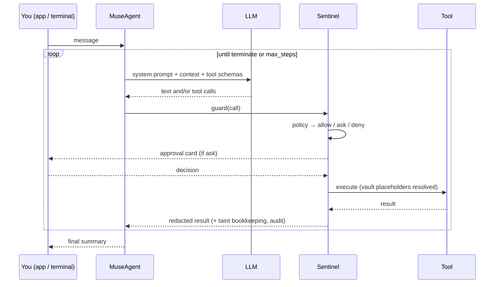

# Architecture

This page maps behaviour to source files. Read it before changing the agent loop, adding a tool, or touching anything Sentinel-related.

## One turn



`MuseAgent.run()` builds the system prompt once per turn (profile, language rule, relevant memories, active goals), then loops: ask the model, hand each tool call to `Sentinel.guard()`, append results, stop when the model calls `terminate` or replies without tools. Messages that arrive mid-turn (from the app) are folded in before the next model call. Stuck detection fires when the same call repeats without progress; `max_steps` forces a wrap-up.

## Source map

| Area | Files | Notes |
|---|---|---|
| Composition root | `nanomuse/app.py` | `NanoMuseApp` wires settings → LLM, tools, vault, Sentinel, memory, goals, agent |
| Agent loop | `nanomuse/agent/core.py` | prompt assembly, context trimming, stuck detection, session persistence, inbox |
| Prompts | `nanomuse/prompts.py` | system prompt, language rule and script detection, goal-advance prompt |
| Sentinel | `nanomuse/sentinel/gate.py`, `policy.py`, `audit.py` | guard, decision order, approvals, taint, vault resolution, redaction, JSONL audit |
| Vault | `nanomuse/vault/vault.py` | Fernet store, `{{vault:NAME}}` placeholders |
| Tool base | `nanomuse/tools/base.py` | `BaseTool`, `CallAssessment`, `ToolCollection`, `safe_execute` |
| Built-in tools | `nanomuse/tools/files.py`, `shell.py`, `web.py`, `email_tool.py`, `browser.py` + `browser_backends.py` (Playwright on the server or the phone's WebView; see [browser.md](browser.md)), `memory_tools.py`, `goal_tools.py`, `terminate.py` | |
| MCP | `nanomuse/tools/mcp_tools.py` | stdio / streamable HTTP / SSE clients, one `MCPTool` per remote tool; per-tool risk overrides from `MCPServerSettings.tools` |
| On a phone | `nanomuse/runtime.py`, `nanomuse/bridge/` | `device()` reads `NANOMUSE_DEVICE*`; `DEVICE_TOOLS` (the Sentinel defaults of the phone's tools) and `device_mcp_server()` (the app's MCP server as the `device` entry, tools `device__*`); the CLI bridge (`/api/bridge/*`, one-command tokens) behind `nanomuse-device` / `nanomuse-browser` / `nanomuse-open`; see [device.md](device.md), [local-runtime.md](local-runtime.md) |
| The phone | `nanomuse/phone/link.py`, `screen.py`, `operator.py`, `trace.py`, `nanomuse/tools/phone.py` | connected devices and request/response over the app's WebSocket; the screen as a screenshot plus a caption; the operator loop (MemGUI `mobile_use` dialect, coordinates on a 999 grid) with its own model; JSONL traces and their HTML rendering; `phone_screen` / `phone_act` / `phone_task` and their Sentinel assessment ([gui.md](gui.md)) |
| LLM | `nanomuse/llm/base.py`, `openai_chat.py`, `openai_responses.py`, `prompt_tools.py`, `factory.py`, `mock.py`; `catalogue.py` + `providers.json`, `chatgpt.py`, `codex.py`, `chatgpt_proxy.py` | `BaseLLM`, streaming with `<think>` filter, retries, prompt-based tool calling, `MockLLM` for tests; the provider catalogue (who covers chat, vision, image, video); the ChatGPT sign-in (PKCE, the token store) and the Chat Completions ↔ Codex Responses translation behind `provider = "chatgpt"` and `nanomuse chatgpt proxy` |
| Memory, goals | `nanomuse/memory/store.py`, `nanomuse/memory/consolidate.py`, `nanomuse/goals/store.py` | SQLite; rare-word (IDF) ranking for memory injection, words in any alphabetic script plus CJK bigrams; the tidy-up planner and its checks, which refuse a merge they cannot judge; a change log with undo |
| External memory | `nanomuse/memory/openviking.py` | Optional OpenViking recall and completed-turn capture through the Sentinel, with an identity-scoped SQLite outbox; local explicit memory stays separate. See [configuration](configuration.md#memory-openviking). |
| Personal profile | `nanomuse/memory/personal.py` | Runtime-local facts derived from eligible user quotes, candidate review, scopes, expiry and correction history; internal learning and retrieval pass through the Sentinel. See [configuration](configuration.md#memoryopenviking). |
| Memory spaces | `nanomuse/memory/hub.py`, `learning.py`, `archive.py` | One runtime owner's stable identity, space-bound stores and tools, durable background learning and explicit version-checked export, clear and restore. Spaces do not provide hosted tenant isolation. See [configuration](configuration.md#memory-spaces). |
| Reviewed facts | `nanomuse/memory/facts.py`, `rules.py`, `access.py` | Alias and profile-version linking, durable cleanup progress, retired-text exclusions and memory-off tool restrictions. |
| Space files | `nanomuse/workspaces.py`, `workspace_runner.py` | Bound file paths, descriptor-based file opens and inherited Landlock command restrictions, with an optional outer bubblewrap layer. |
| App server | `nanomuse/server/service.py`, `api.py`, `webui.py`, `events.py` | threads and workers, REST + WebSocket, `UI` implementation that turns callbacks into events, timeline persistence |
| Front-end | `web/src/` | React + TypeScript + Tailwind; `store.tsx` (state, WebSocket), `screens/` (tabs), `components/` (cards, avatar, markdown) |
| Terminal | `nanomuse/console.py`, `nanomuse/cli.py` | Rich console UI with inline approvals; Typer commands |
| Config, schema | `nanomuse/config.py`, `nanomuse/schema.py` | Pydantic settings, message and tool-call models |

## The `UI` protocol

Anything that can show the agent to a person implements `nanomuse/ui.py::UI`: text deltas, assistant messages, tool calls and results, Sentinel notices, `ask_approval()` and `ask_user()`. `ConsoleUI` is the terminal; `WebUI` turns the same callbacks into timeline events and WebSocket messages and parks approvals in futures until the app answers. A Telegram or desktop front-end would be another implementation of the same protocol, or a client of the HTTP API.

## Threads in the app

`MuseService` keeps one `MuseAgent` per thread, each with its own conversation and worker task, sharing the vault and audit log. Each thread binds its memory and workspace through `MemoryHub`; personal stores and connectors remain in Personal. The main thread is the long conversation; side chats are separate threads; background goal passes run in their own thread and post a summary to the main one. A `contextvar` tells `WebUI` which thread a callback belongs to.

## Extension points

| Want to add… | Do this |
|---|---|
| A tool | subclass `BaseTool` in `nanomuse/tools/`, set `risk`, override `assess()` if a call can be more dangerous than the default, register it in `app.py::_build_tools`, add a test with `MockLLM` |
| A connector | prefer an MCP server (`[[mcp.servers]]`); write a tool only if the protocol does not fit |
| A model provider | most endpoints are covered by `openai` / `openai_responses`; otherwise implement `BaseLLM` and register it in `llm/factory.py` |
| A front-end | implement `UI` or drive the HTTP/WebSocket API in `docs/app.md` |
| A Sentinel behaviour | `policy.py` for decisions, `gate.py` for what happens around execution |

## Tests

```bash
python -m pytest -q                 # unit tests with MockLLM, no network
NANOMUSE_LIVE=1 python -m pytest -q -m live    # smoke test against your configured model
ruff check nanomuse tests && ruff format --check nanomuse tests
cd web && npm run build             # type-checks and rebuilds the app
```

`tests/test_server.py` drives the app server end to end with a scripted `MockLLM`: sending messages, approval cards, questions, goals, memory, files, settings.

## Necessary interruption evaluation

Necessary Interruption Rate (NIR) measures how many blocking questions genuinely required a user answer at that point in the task:

`NIR = necessary blocking questions / all blocking questions`

The unit is one requested decision, not one message. Split a message that asks several independent questions into separate entries. Count repeated questions each time they block progress, including unanswered or dismissed requests. Include `ask_user`, plain assistant replies that stop for an answer, Sentinel approvals and human handovers. Report these four channels separately as well as together, so required safety approvals cannot hide unnecessary clarification. A follow-up offered after delivering the requested work is non-blocking and stays outside the denominator.

Judge necessity against the user's request, progress so far, authorization and information available at the time. A missing recipient, an exact reminder time or an unapproved purchase can require the user. A question is unnecessary when applicable confirmed context already answers it, an authorized tool could retrieve the answer, a safe reversible draft would meet the request, or the same unchanged action already has the required permission. Do the useful independent preparation before asking. A memory preference is available only when memory is enabled, its space and scope apply, and it is current and confirmed. An old preference does not authorize spending or contacting someone. Existing Sentinel requirements still apply.

`nanomuse/evaluation.py` aggregates **independently reviewed** task records. It does not infer necessity from the assistant's explanation. A reviewer checks the complete transcript, records every requested decision, adds evidence for each necessity verdict and confirms `inventory_complete`. The module cannot detect an omitted question or prove that a supplied judgment is correct. Real evaluations need consistent task samples and reviewers who are separate from the evaluated assistant; resolve disputed labels before marking the review complete. Include tasks without questions to detect silent failure and unauthorized guessing.

Run the synthetic format example from the repository root:

```bash
python -m nanomuse.evaluation tests/fixtures/interruptions.example.json --require-complete
```

This example contains deliberately good and bad transcripts. Its score validates the accounting, **not nanoMuse's measured behavior**. For an actual evaluation, copy the JSON structure and replace the tasks with reviewed runs. Each task supplies `context`, `reviewer`, `inventory_complete`, `completion` (`completed`, `partial`, `failed` or `null`), `unauthorized_action`, `missed_necessary_questions` and `interruptions`. Each interruption supplies an ID, `channel` (`ask_user`, `assistant`, `approval` or `handover`), the question, `blocking`, and a `verdict` (`necessary`, `unnecessary` or `null`) with `evidence`. Reviewed judgments require a reviewer; necessity verdicts require evidence. Non-blocking questions have no necessity verdict. `null` means unreviewed, never a successful result. IDs are unique per task and per question within that task.

The JSON report includes the question counts, channel breakdown, inventory and label coverage, task completion rate, the fraction of tasks with unauthorized actions, and missed necessary questions. Rates are fractions from 0 to 1. NIR stays `null` when no blocking questions occurred, any blocking question is unreviewed, or any task's question inventory is incomplete. Bounds apply only to the recorded questions and do not compensate for missing inventory. Completion and safety rates also stay `null` until their respective task judgments are complete. `--require-complete` exits 1 for incomplete reviews and 2 for invalid input; exit 0 confirms complete review data, not acceptable agent performance.

Compare versions on the same tasks and authorization conditions. Include paired cases with and without an applicable preference to see whether memory removes redundant questions. A higher NIR is useful only alongside stable or better task completion, no additional unauthorized actions and no additional missed necessary questions. This is an offline evaluation tool, not an automatic production dashboard or a reason to bypass the Sentinel.
