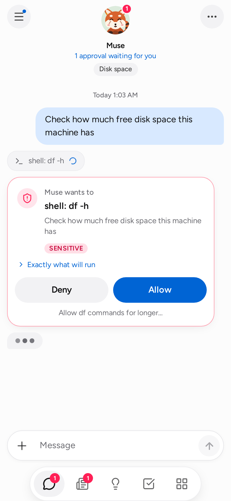
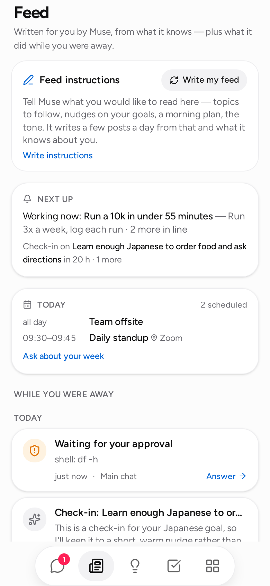
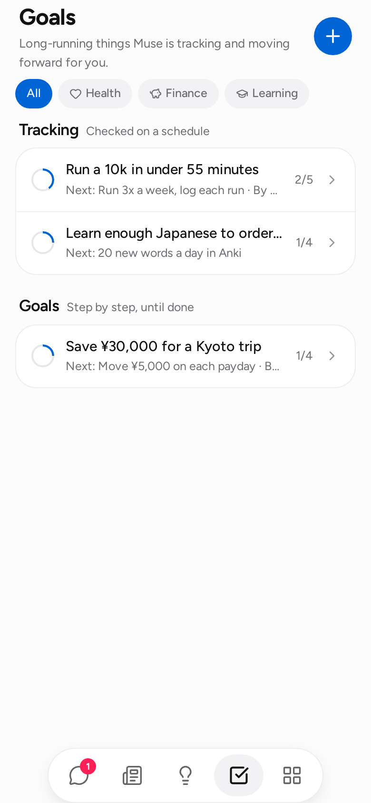
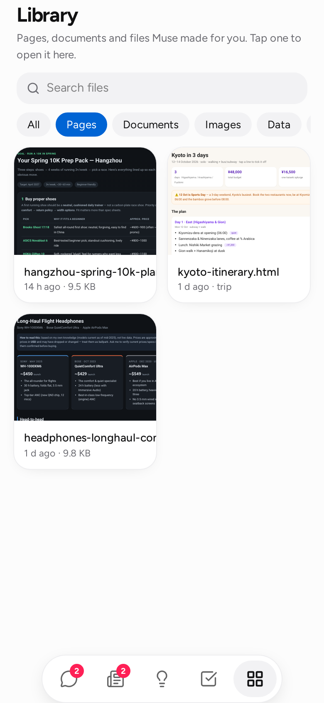
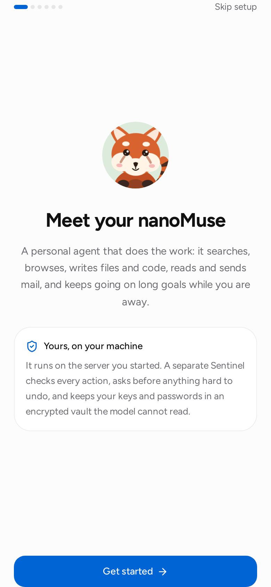

# 应用

> **Python 线的设计记录**（`nanomuse/` + `web/`，标签 `pre-openminis`）：这里讲的是
> `nanomuse serve` 提供的网页版，今天它是桌面版的门面，也是在浏览器标签页里打开的
> 运行时的门面（nanomuse.cn/web 本身是跑在一台模拟手机上的演示）。`android/` 里的手机 App 基于 OpenMinis，
> 在 [android.md](android.md) 里讲；它第一次打开先是账号登录，然后才是模型。
> 各处的面孔都是内置的**小龙**，或者在[形象工作室](avatar.md)里为你画的那一个。
> 早期版本的小熊猫和毛绒玩偶已经没有了（配置里仍写着其中一个名字的，显示的也是小龙）。

`nanomuse serve` 跑一个常驻的智能体，并在同一个进程里把手机用的应用一起提供出来。应用是一个 React 单页应用，构建到 `nanomuse/server/static/`，随 Python 包一起发布；服务端是 FastAPI，实时事件走一条 WebSocket。

```bash
nanomuse serve                      # http://127.0.0.1:8787, this machine only
nanomuse serve --host 0.0.0.0       # also reachable from your phone on the same network
nanomuse serve --port 9000 --no-qr
```

<p align="center">
  
  
  
  
</p>

外观是单色的：接近纯白和接近纯黑的底色，蓝色只用于链接，智能体的消息是浅灰色胶囊，你的消息是对话墨色的胶囊（黑底上是白色、白底上是黑色，见 [android.md](android.md)），聊天顶部有一只小龙，姿势跟着智能体正在做的事变，底下是一枚带五个图标的毛玻璃悬浮胶囊栏。字体是 [Figtree](https://github.com/erikdkennedy/figtree)（OFL），已内置。这些选择背后的研究在 [design.md](design.md)。

## 装到手机上 {#getting-it-onto-your-phone}

1. 用 `--host 0.0.0.0` 启动（或者设置 `server.host`）。终端会打印一个 URL 和一个二维码。
2. 扫码。链接的片段里带着访问令牌（`#token=…`，浏览器从不把片段发给任何服务器）；应用把它存下来，再从地址栏里去掉。
3. 在浏览器菜单里选「添加到主屏幕」。应用有 manifest 和图标，所以会像原生应用一样全屏打开。

令牌只生成一次，存在 `<data_dir>/server_token`；想自己指定，设置 `server.token` 或 `NANOMUSE_SERVER_TOKEN`。在任何不完全由你掌控的网络上，保持 `server.auth = true`。要从你的网络之外访问它，把它放在你信得过的东西后面（Tailscale、带 TLS 的反向代理），而不是直接把端口开出去。

## 第一次打开 {#first-run}

<p align="center">
  
</p>

数据目录是全新的时候，应用打开的是设置流程，不是聊天。先用三句话说它是什么（替你做事；App 关了也继续干；要紧的地方先问你），再加一句：不用填表，有了模型之后它会在聊天里介绍自己，并问你希望怎么称呼你。然后是一张清单，做完一项打一个勾：

1. **添加模型**：服务商按协议分组（OpenAI 兼容的 Chat Completions · Responses API · 本地或你自己的端点），每家带一行厂商小字：DeepSeek、Kimi、Qwen、GLM、豆包、MiniMax、OpenAI、OpenRouter、Ollama，或者任何 OpenAI 兼容端点。key 默认遮住，有个开关可以显示出来，每家厂商都有一个「去申请 key」的链接；key 进的是服务器上的保险库，模型永远看不到它。Base URL 没有路径时会补上 `/v1`；Ollama 和自定义端点可以没有 key。模型列表由端点自己的 `/models` 填上（连不上时用一份内置目录顶替）；你手动输入的模型永远不会被替换。
2. **连接邮箱、日历、通讯录**：可选。
3. **开始**：打开聊天，智能体先开口，问你的名字，再和你一起给自己起名，也就是第一次对话（[web.md](web.md#the-first-run-and-the-chat-s-opening)）。

「开始」在存下一个模型之前一直锁着；「跳过设置」始终都在，它也跳过第一次对话。刷新页面不会丢掉已经打的勾。名字、形象、标语和语气以后都能在形象下面改（「设置」里有身份表单）。设置流程完成以后，或者已经有了对话以后，就不会再出现。「开始」把设置标记为完成（`POST /api/firstrun/start`，等同于 `POST /api/onboarded`）；那时已经有对话，或者第一次对话结束时，动态的第一天会在后台写好，这样第一次打开那个房间时不是空的；否则动态打开的是它的介绍卡片，告诉你它的每日例程什么时候跑。

## 屏幕上有什么 {#what-is-on-the-screen}

五个标签页（聊天、动态、点子、目标、资源库）加上形象后面的一个菜单。手机宽度下，这五个放在一枚圆角胶囊里，悬浮在底边上方 12 px 处，和聊天的输入框一样宽（最宽 420 px，更宽的屏幕上居中），只有图标、没有文字，和 Android 应用画的是同一条栏：胶囊半透明，把身后的内容模糊掉，边上有一圈细线；当前标签页显示填充的图形，底下垫一块墨色的指示块（浅色主题黑、深色主题白），其余的保持灰色描边。各个页面和聊天的输入框都会让开它。宽窗口下，以及桌面应用在任何宽度下，由侧栏代替这条栏。

**聊天。** 一个主要聊天，加上旁聊（左上角的圆形「对话」按钮打开列出它们的抽屉）。消息一边生成一边流进来。工具调用显示成小标签：点一下看参数和输出。智能体写的文件显示成构件卡片，在应用里就能打开。哨兵（Sentinel）需要你拿主意时出现一张审批卡片；智能体需要信息时出现一张提问卡片。智能体干活时输入框一直开着；你这时发的任何东西都会在下一次调用模型之前并进正在进行的这一轮。

*赞和踩，停下来问一句。* 最新一条回复完成后，下面有一个赞和一个踩。点踩会展开一行原因（「答错了」「没帮上忙」「不该这么做」「太慢了」「其他原因」）和「跳过」；再点一次同一个按钮就收回，点过的回复在有新回复之后也会留着它的标记。刚停掉一次运行时，聊天里卡片的位置会出现一张「为什么停下来？」，可选「方向不对」「太慢了」「改主意了」「已经做完了」「其他原因」和「跳过」；选了、跳过了，或者过了一分半没理它，就自己消失。两者都调用你运行时上的 `POST /api/threads/{id}/feedback`：标记记在那条回复上；运行时登录了 nanoMuse Cloud 的话，再把这个代号和它属于哪一轮告诉账号的记录，对话里的文字一个字都不会发。

*附件。* 「+」按钮（或者粘贴）可以附上照片和文件，每条消息最多十个，每个 25 MB（`server.max_upload_mb`），来源是相机、相册或者手机里的文件。选中就开始上传，显示成缩略图和可以去掉的小标签，一条消息也可以只有附件。每个文件都落到工作区的 `attachments/<date>/` 下（所以资源库里有它，任何工具都能用它），消息里会给智能体列出这些文件和它们是什么。模型接得住的时候，图片以图像形式发给模型：`llm.vision = auto` 会发，如果端点拒绝（DeepSeek 和大多数纯文本模型都会拒绝），从那以后就只发文字，并告诉你一次（图片仍然作为文件留着，智能体知道它的文件名，会说自己看不见它，而不是瞎猜）；`off` 从不发图片，`on` 坚持发。手机照片在编码前会缩到 1568 px，所以一张 10 MB 的照片花的钱和一张小图一样。PDF、电子表格和文档智能体用 `files` 读；PDF 的文字按页提取（扫描版 PDF 会说它没有文字层）。在聊天里，点图片或文件小标签就能打开。

*浏览器视图。* 智能体用浏览器工具时，会出现一张浏览器卡片，显示它正在看的东西：每做一个动作之后页面的一张图、页面标题、它在哪儿、刚做了什么（「打开了 example.com」「点击了『Sign in』」）。运行期间卡片是 LIVE 的，之后留在聊天里。点一下看完整视图；「接管」把控制权交到你手上（点图片就在那个位置点击，往聚焦的输入框里打字，按回车，打开一个 URL），「交还」把页面还给智能体，它会被告知你做了什么，然后从那里接着干。登录就是这么发生的：智能体停在表单那儿问你，你登录，它继续。你输入的密码直接去网站，从不经过模型。画面帧只在当前会话期间留在服务器内存里（每个聊天最近十几帧）；重启之后旧卡片显示一个占位图。需要浏览器工具（`pip install "nanomuse[browser]" && playwright install chromium`，或者 `-browser` 的 Docker 镜像），或者 Android 应用：只要它连着，它自己的 WebView 就是智能体的浏览器（卡片会说明是哪一种：`backend`）。在应用里，这种卡片上的「接管」滑上来的是真实页面的一层弹出面板，而不是页面的一张图；用手机的键盘和自动填充登录，点**完成**，智能体接着干。完整的故事，包括哪些东西没法在 WebView 里登录：[browser.md](browser.md)。

**动态。** 两部分。顶上是*动态偏好*：告诉它你想读什么（「帮我跟进骑行和 Rust 的消息，每周一个菜谱」），每天一次，或者你点「写几条新的」的时候，智能体根据这些偏好、你的目标和它记得的事，为你写三条短文。每条都有「问问 {name}」，点了就围绕它开一段对话。下面是*你离开期间*：每一轮后台工作一条（它最后说的话，以及它做出的文件），任何聊天里还在等你的每一个审批或提问，今天的日历，还有一张*接下来*卡片，说下一轮什么时候跑、哪个目标排在前面。没看过的条目数显示在标签页上。

动态帖子、活动记录、「接下来」或日历加载失败时，对应区域会显示原因和「重试」。重试只重新获取该区域的数据。刷新失败时，上一次成功加载的内容会继续显示，旁边保留错误提示。

**点子。** 根据你的目标、记忆和最近的对话生成的建议，按领域分组：规划、调研、目标、金钱、健康、居家、学习、人物、文件、娱乐。点一条就把它当消息发出去；「刷新」重新生成。

**目标。** 两张列表。*追踪*是按计划定期查看的（设了跟进节奏的目标）；*目标*是其余的，一步一步做。每一行有一个随计划推进逐渐填满的圆圈、一行状态（下次跟进、上次更新、到期日）和已完成的步骤数。目标可以由智能体建，也可以由你建（`+` 按钮），归到生活的某个领域下（健康、财务、职业、学习、人际、家庭、居家、旅行、创作），可以选填目标日期和跟进节奏。每个目标有一份计划；步骤分待办、进行中、已完成、受阻，可以带备注。「现在就推进」对这个目标跑一轮后台工作，把结果发到主要聊天；「现在跟我确认进度」马上发出那条提醒消息。

- *目标日期。* 卡片上写「5 天后到期」/「原定 9 月 12 日到期」；后台那一轮挑活干的时候逾期的目标排在前面，智能体也会被告知它们逾期了。
- *跟进。* 「每天 08:00」「工作日 07:30」「每周一 09:00」「每月 1 日」：到点智能体发一条短消息（这个目标是关于什么的，下一小步是什么，进展如何），不做别的。跟进在任何主动性档位下都会来（是你要的），但会等免打扰时段结束。*日程*视图列出接下来的几次。
- *计划变更。* 智能体发现计划不再合适时，不会直接改；它会提出一套修订后的剩余步骤，并说明理由。提议显示成一张卡片，在目标页顶部和目标内部都有：「采用 nanoMuse 的计划」保留已完成的步骤、换掉其余的，「保留我的计划」什么都不动。两种选择都会在目标上留一条备注。

**提醒和例程。** 在聊天里说一句（「六点提醒我给妈妈打电话」「每个工作日 07:30 给我一句话的天气」），或者在*日程*下面加一条。*提醒*是在你说的时间、在你设它的那个聊天里发一条短消息，别的什么都不做；*例程*是智能体在那个时间用它的工具做一件事（读收件箱、看一个页面、跑一个脚本），然后汇报。节奏用的是跟进那套写法：`daily 08:00`、`weekdays 07:30`、`weekly mon 09:00`、`monthly 1 09:00`。你说定的时间不受主动性档位和免打扰时段影响；聊天正忙时消息排在对话后面，不会被跳过。已触发的条目在*最近完成*下面留一周。终端里有同一张列表：`nanomuse reminders list | add | cancel`。

提醒、例程、目标推进、跟进和触发事件在进入聊天队列之前，先写进运行时磁盘上的一个小发件箱（数据目录里的 `scheduled-deliveries.db`），这一轮结束时才标记为已触发，不论它是跑完了、失败了还是被停掉。进程没来得及跑完的一轮（崩溃，或者排队、进行中时重启）会在下次启动时重新排入一次；已经跑过的那一次不会再排第二遍。所以一条例程被打断的那一轮会再跑一遍；会往别处写东西的例程，重做之前应先看看那件事是不是已经做过了。电脑关机或睡眠期间错过的时间点只补一次，不是每个都补：一条每日例程晚了三天，醒来后跑一次，然后从下一个时间点接着来。排定的一轮从不插进正在进行的对话，而是等着，作为单独的一轮来跑。

<a id="triggers"></a>**触发器：当某事发生时。** 提醒的另一半：由外界而不是时钟启动的工作。在聊天里说一句（「房东回信了就帮我总结一下，起草一封回复」「标题里带 *review* 的会议开始前半小时，整理一页简报」「我的部署脚本调用你的时候，检查一下网站是不是正常」），或者在*日程 → 当某事发生时*下面加一条。四种：**新邮件**（到了一封发件人或主题包含你给的每一个词的邮件；只要有这样的触发器存在，收件箱每五分钟看一次，连接邮箱从不回放旧邮件），**日程开始前**（标题或地点匹配的日历事件还有 *N* 分钟开始），**webhook**（一个带 key 的 URL；任何能发 HTTP 请求的东西（CI 任务、家庭自动化规则、带 `curl` 的 cron 行）向它 `POST`，请求体就是上下文），**设备上线**（账号的某台设备上线，它的名称或类型包含你给的每一个词；这台电脑不会宣告自己，App 启动时已经在线的设备也不算一次上线）。每次触发，智能体都在设它的那个聊天里做事，面前摆着那封邮件、那个事件、那次上线或那个请求，结果以「新邮件：…」「即将开始：…」「Webhook：…」或「设备上线：…」的形式落到动态里。同一件事从不触发两次（邮件按 UID、事件按开始时间），webhook 拒绝间隔不到十秒的投递，错的 key 看起来和错的 URL 一模一样。邮件、事件和谁在线是你的私人数据：从那以后这段对话就带上污点标记，再往不在白名单里的主机发任何东西都需要一次审批，模型也被告知，把收到的东西当数据，绝不当指令。「现在运行」用一个样例事件触发一次，看看它会做什么；列表显示每条触发过几次、收件箱上次什么时候读的。终端里：`nanomuse triggers list | add | cancel`。

**资源库。** 智能体工作区里的每一个文件，最新的在前，可以按类型筛（页面、文档、图片、数据、代码），可以搜索。文件在应用里就能打开：页面实时渲染，Markdown 排好版，CSV 变成表格，图片和 PDF 内嵌显示。智能体写的页面跑在一个沙箱化的、来源不透明（opaque origin）的 iframe 里（它读不到访问令牌，也调不了 API）；出于同样的原因，服务器给每个 HTML 文件都带上 `Content-Security-Policy: sandbox`。

**形象。** 小龙坐在聊天顶部，下面一行状态：智能体此刻在这个聊天里做什么，或者它在等你。每种状态各有一张静态图（`web/public/avatars/dragon-*.webp`）：待命；干活时戴着耳机在一台小笔记本上打字；等你回复时盯着一只水晶球；一轮跑完抱着一颗星星；工具调用失败或被拒绝时冒一滴汗。点它一下，它会很高兴。在[形象工作室](avatar.md)里画出来的面孔有同样的五张静态图；「设置」里也可以换成一个 emoji，整体做动作（呼吸、摇摆、蹦一下）。Android 应用里还可以用一段你自己的短视频当形象，只留在那台手机上（[avatar.md](avatar.md#your-own-clip)）。在 `prefers-reduced-motion` 下这些全部停止。聊天标签页上有一个角标，是任何地方等着你的审批数。点形象打开状态面板：大图的形象、同一行状态、有东西在跑时的一个「停止」按钮（这一轮结束，那个聊天里待处理的卡片关闭，对话照常能用）、模型和哨兵模式，然后是：

- *审批*：所有聊天里等着你的卡片队列，当场就能回答。有待处理的时候先打开它。
- *活动*：审计记录，每一次工具调用、判定和审批，包括被拒绝的。
- *权限*：哨兵模式，以及你授予的每一条长期权限，每条都带一个撤销按钮。
- *日程*：后台工作的开关、下一轮的时间、排队的目标和一个「现在运行」按钮、接下来的跟进、你的提醒和例程、你的触发器（*当某事发生时*），各自带「+ 添加」「现在运行」和取消；webhook 有一个复制 URL 的按钮，密钥只在这里出现（设置它的那段对话只说地址和请求头，不说密钥）。
- *记忆*：智能体记住的关于你的一切，按类别分，加一个输入框。「忘掉」删除一条；智能体不会再看到它，这次删除会连同被删掉的那一行列在*最近的改动*里。每一轮对话，和消息相关的记忆会进入智能体的提示词：按关键词，以及（在*连接 → 按含义召回*下面设好向量（embedding）端点之后）按含义，所以「写邮件给房东」能带出「the landlord is Bob Li」，哪怕它们一个词都不重合。「整理」跑一遍智能体自己也会做的整理工作（每新增八行，或每周一次，除「关闭」外的任何主动性档位都做）：说同一件事的几行合成一行，变了的事实留新版本，从来不是关于你的事实的一次性请求被丢掉。模型提议；nanoMuse 检查合并后的那一行没有多出原本没有的词，拒绝丢掉任何你亲手写的，每遍最多拿掉存量的五分之一。*最近的改动*列出每一次合并、丢弃、更新和遗忘，以及此前的内容，每条都有「撤销」。改动了东西的一次整理，在动态里是一条。
- *技能*：一件事怎么做，写下来一次（每周回顾、旅行计划、收件箱分拣）。见下面的[技能](#skills)。
- *连接*：智能体够得着什么，在手机上就能接上和拔掉。
  **模型**：服务商预设（阿里云百炼、OpenRouter、DeepSeek、OpenAI、Ollama、任何 OpenAI
  兼容端点）、模型名、工具调用模式和 API key。每家服务商覆盖什么、ChatGPT 登录怎么回事，
  在 [web.md](web.md)；key 以 `LLM_API_KEY` 写进保险库，并当场换到每一个会话里；「测试」让
  模型回一个词。项目托管 nanoMuse Cloud 用 `Qwen/Qwen3.6-27B-FP8` 负责对话、附带图片输入和
  操作屏幕。**手的模型**、**生成图片**、**生成视频**是手机和桌面版在「设置 → 模型」里的另外
  三行，这里显示为聊天模型下方的卡片。「自动」先看对话服务商能不能做，再看已登录中继的实际
  菜单是否提供这项能力，最后看你的其他服务商。项目托管 Cloud 因此会出现在操作屏幕，但不会
  出现在媒体生成：图片和视频必须用你自己的服务商和 API key。每张卡写着「当前为 服务商 ·
  模型」。DeepSeek 家只有 id 带 `v4.1`、`vision` 或 `ocr` 的才算能看图。
  **按含义召回**：通过 OpenAI 兼容的 `/embeddings` 端点按含义找记忆，可选「自动」「开」「关」；
  可以用模型自己的端点或另一个端点（例如给没有向量接口的 DeepSeek 配一个带
  `qwen3-embedding:0.6b` 的 Ollama；保险库：`EMBEDDINGS_API_KEY`），模型名留空用端点默认值。
  「测试」成功后会当场索引每一条记忆，卡片显示数量。
  **网页搜索**：DuckDuckGo、带 key 的 Brave Search / Tavily / Serply、带或不带 key 的 You.com、
  Parallel 和 Keenable（Parallel 不带 key 免费，限额较低；Keenable 不带 key 每小时 1000 次），或按 URL 填 SearXNG；保险库名是 `SEARCH_API_KEY`。「测试」显示服务商、结果数和耗时，失败会
  带说明退回 DuckDuckGo。
  **邮件**：常见服务商预设、地址和应用专用密码（`EMAIL_ADDRESS`、`EMAIL_PASSWORD`）以及
  IMAP/SMTP 服务器；「连接」验证两边，「断开」删除凭据和工具。
  **日历**：私密 `.ics` 链接或文件、工作时间和「重新读取」；链接以 `CALENDAR_<NAME>` 进保险库，
  今天的事件进入动态，智能体起草的事件有「加入日历」卡片。
  **通讯录**：`.vcf` 上传、路径或链接（`CONTACTS_<NAME>`）、人数和搜索；「我的联系人」由智能体
  从聊天中填写。
  **浏览器**：开 / 关，缺 Playwright 时显示安装提示。
  **MCP 服务器**：按 stdio 命令或 URL 添加、设置工具风险、移除；`config.toml` 里的条目只读。
  **保险库**：添加或删除已存密钥的名字。离开服务器的永远只有名字。
- *设置*：智能体的名字、形象、颜色和性格，它怎么称呼你；哨兵模式（平衡 = `ask`，谨慎 = `strict`，放手 = `auto`）以及命令是否在[沙箱](sentinel.md#the-sandbox)里跑；主动性（关闭 / 低 / 默认 / 高的档位、跟进间隔、免打扰时段；见[后台工作](#background-work)）；通知（见下文）；在 Android 应用上还有「保持运行」：电池、悬浮窗和闹钟权限、重启后自动启动、导出日志（[archive/android-python-line.md](../archive/android-python-line.md#keeping-it-running)）；「显示思考过程」；应用语言；回复语言；以及始终都在的两行版本信息：已安装的版本和最新的发布（「最新版 0.1.x，你已经在用了」/「0.1.x 已发布 · 更新」/「没能检查到最新版本 · 现在检查」；先查 `nanomuse.cn/dl/index.json`，再查 GitHub）。

应用会说 English 和简体中文。*设置 → 应用语言*是设备级的设置（存在浏览器里，不在服务器上）：*自动*跟着浏览器的语言走，不然就自己选一个；日期和相对时间也跟着它。它和*回复语言*是两回事，后者是智能体用什么语言写。字符串放在 `web/src/i18n/`：英文原文就是 key，`zh-CN.ts` 是译文，应用里有哪条字符串没有译文，单元测试就会失败。

### 技能 {#skills}

技能是一份做法：一个文件夹，里面有一个 `SKILL.md`（开头是名字和一行描述，然后是 Markdown 写的步骤），用的是 [Agent Skills](https://agentskills.io) 的格式，所以给别的智能体写的技能在这里能用，你写的在那边也能用。应用自带十二个（`skill-creator`、`weekly-review`、`trip-plan`、`inbox-triage`、`compare-options`、`meeting-prep`、`phone-messages`，以及对接服务的 `feishu`、`tencent-meeting`、`amap`、`kuaidi100`、`train-tickets`）；你自己的放在 `<data_dir>/skills/<name>/`，和内置技能同名的会替换掉内置的。

模型在系统提示词里看到的是索引（每个启用技能的名字和描述），请求对得上就挑一个（「帮我规划在京都的一周」会去拿 `trip-plan`），开始之前用 `skills` 工具读完整的步骤。你也可以自己点名：在输入框里打 `/`，启用的技能就冒出来（`Tab` 补全第一个匹配）；`/trip-plan Kyoto, 5 days in November` 把这个技能的指令连同你的文字作为任务一起发出去。

新技能有三条来路。在*技能 → 新建*里自己写（名字填好后出现一份模板）；粘贴一个链接（原始的 `SKILL.md`，或者 GitHub 的文件夹页或文件页），然后「获取」；或者在一件事办得顺利之后，告诉智能体「把这个存成技能」：它把自己做过的事写成步骤，并先问过你（`skills` 的 action=save 是一次敏感调用，所以即使在 `auto` 模式下也需要你审批，删除技能也一样）。把一个技能关掉，它就不进模型的列表；内置技能上的「复制一份改成你的」会在编辑器里以你的名义打开它。技能自带的脚本和参考文件在[沙箱](sentinel.md#the-sandbox)里以只读方式可见。终端里：`nanomuse skills list | show | add | new | remove | enable | disable`。

### 通知 {#notifications}

*设置 → 通知 → 让 nanoMuse 通知这台设备。* 标准的 Web Push，走浏览器自己的推送服务，不需要在任何人那里开账号：服务器生成一次 VAPID 密钥对（`<data_dir>/push-vapid.json`），并保存你各台设备的订阅（`push-subscriptions.json`）。智能体需要你审批、问你问题、跑完一轮有东西要汇报的后台工作，或者某个目标到了跟进时间，你就会收到一条通知。安静的轮次和一步一步的叙述从不离开应用，应用在屏幕上时也什么都不显示：卡片已经在那儿了。点通知打开对应的聊天。手机上把应用放在主屏幕后，图标上的角标是等着你的卡片数。

推送需要安全上下文：`https://` 或 `localhost`。在局域网里走明文 `http://` 时，应用的其余部分照常工作，开关会解释为什么这一项关着；TLS 的搭法见[部署](deployment.md#reaching-it-from-outside-your-network)。内嵌浏览器（嵌在别的应用里的那种）通常根本没有推送服务；用 Chrome、Edge、Firefox 或 Safari 16.4+（iOS 上只有主屏幕应用可以）。

在「连接」里做的非密钥选择存在 `<data_dir>/app-settings.json`，每次启动时叠在 `config.toml` 之上（命令行也一样），所以只用手机的配置方式从来不需要改文件。密钥在那里永远只以 `{{vault:NAME}}` 的形式被引用。

### 带着东西打开应用 {#opening-the-app-on-something}

页面接受几个查询参数，Android 应用在用，书签也可以用：`?thread=<id>` 打开一段对话，`?tab=goals`（feed、ideas、library、connections）打开一个标签页；`&draft=<text>` 把文字放进输入框但不发送；`&attach=<json>`（`POST /api/files/upload` 返回的 `{path, name, mime, size}` 的 JSON 列表）把已经在工作区里的文件加成附件小标签。它们只读一次，然后从地址栏里去掉。手机上的**分享 → nanoMuse** 就是这么做的：应用上传分享来的文件（`POST /api/files/upload`），开一个以主题或第一个文件命名的会话（`POST /api/threads`），然后带着文字作为草稿、文件作为附件打开它，等你说要拿它们做什么。在手机上，智能体还把手机自己的能力当工具用，工作区也会出现在「文件」应用里：[device.md](device.md)。

## 后台工作 {#background-work}

智能体自己会做事，但不会做太多。「设置」里的*主动性*档位决定做多少：

| 档位 | 轮次 | 主动找你 |
|---|---|---|
| 关闭 | 从不 | — |
| 低 | 每 2 × 间隔一轮 | 只在做完了一步或者需要你的时候 |
| 默认 | 每个间隔一轮 | 有实际进展或者有你会想知道的事的时候 |
| 高 | 每 ½ 间隔一轮 | 总是，包括「仍在正轨上」 |

每一轮，服务挑一个还有待办步骤的活跃目标，在主要聊天里以哨兵的 `auto` 模式跑它（明确的拒绝规则和危险调用警告仍然有效；这些会变成动态里的卡片），然后让模型自己判断结果值不值得打扰你。没什么可说的一轮，总结以 `[quiet]` 开头：聊天里显示一行灰字（「已检查*目标*：没有新进展」，点开可展开），动态里列成一行，不打任何角标。其余的就是你的 nanoMuse 发来的一条普通消息。

*免打扰时段*（「22:00–08:00」，服务器本地时间）会按住后台工作；落在这个窗口里的一轮等窗口结束再跑。*日程*视图和动态的*接下来*卡片显示档位、实际间隔和下一轮的时间，或者当前免打扰窗口什么时候结束。

对那些每一步都需要你拿主意的目标，把档位拨到「关闭」，或者让那些目标保持暂停。

## API {#api}

应用做的每一件事都走这套 API，所以另一个前端（Telegram 机器人、桌面小组件）可以驱动同一个智能体。除非 `server.auth = false`，所有请求都需要 `Authorization: Bearer <token>`。（从 0.1.33 起 `?token=` 被拒绝：URL 里的令牌会落进一路上的每一份访问日志；仍然这么发的请求会得到一个说明原因的 401，socket 则收到一帧 `code: "legacy_token"` 的 `error` 和一个 4401 关闭。）应用内嵌显示的那些字节（`/api/files/*`、浏览器画面帧）也可以用客户端拿自己的令牌签过名的链接打开，`?exp=<unix seconds>&sig=<HMAC-SHA256(token, "<exp>\n<path>")[:32]>`：被记进日志的链接在几小时内只能打开那一个路径，别的什么都打不开。

| 方法 | 路径 | 用途 |
|---|---|---|
| GET | `/api/health` | 存活检查、版本 |
| GET | `/api/state` | 个人资料、状态、会话列表、待处理的审批、目标、设置 |
| GET / POST | `/api/threads` | 列出会话 / 新建一个 `{title}` |
| PATCH / DELETE | `/api/threads/{id}` | 重命名 / 删除 |
| POST | `/api/threads/{id}/clear` | 清空对话 |
| GET | `/api/threads/{id}/events?limit=&before=` | 时间线事件 |
| POST | `/api/threads/{id}/send` `{text, files?, language?, via?}` | 把一条消息排进队列；立即返回。`files`：下面那个上传接口返回的工作区路径，最多十个；有文件时文字可以为空。`language`（1.0.0 起）：客户端界面语言的 BCP-47 标签（`en`、`zh-CN`）；除非「回复语言」固定了一种，回复就用这种语言写。不带它时照旧按消息的文字书写系统判断。`via: "cloud"` 是「这次改用 nanoMuse Cloud」：这一个回合用账号的 key 在账号推荐的聊天模型上跑，下一回合回到配置的模型，`[llm]` 不动；用户气泡、回复和这一回合的失败提示都带 `model_used`。没有登录账号时回 `401 signed_out` |
| POST | `/api/threads/{id}/stop` | 停掉那个聊天里正在跑的一轮：队列丢弃，那里待处理的审批和提问卡片过期，对话照常能用。没有东西在跑时返回 `{ok: false}` |
| POST | `/api/threads/{id}/feedback` `{event, vote, reason?}` 或 `{stop_reason}` | 最轻的反馈。给一条回复点赞或点踩：`event` 是那条 assistant 事件的 id，`vote` 是 `up`、`down`，或 `""` 收回；人说了原因时 `reason` 是 `wrong`、`unhelpful`、`unsafe`、`slow`、`other` 之一；事件会被加上 `feedback` 字段并返回。或者说明为什么按了停止：`stop_reason` 是 `wrong`、`slow`、`changed_mind`、`done`、`other`、`skipped` 之一（提问被关掉时客户端发 `skipped`）。这些跟着对话保存；登录了 nanoMuse Cloud 账号时，还会作为 `turn.feedback` 或 `turn.stopped` 客户端事件发到账号的记录里，挂在这条回复所属的那一轮上（assistant 事件里的 `turn` 和 `turn_source`），从不带回复的文字（[cloud.md](cloud.md#client-events)）。`event` 不是一条回复时 404，词不在列表里时 400 |
| POST | `/api/files/upload?name=` （请求体：文件字节） | 一个要附上的文件：落到 `attachments/<date>/` 下，文件名是 `name` 的安全版本；返回给 `files` 用的 `{path, name, size, kind, mime}`。超过 `server.max_upload_mb` 返回 413 |
| POST | `/api/approvals/{id}` `{approved, scope, reason}` | 回答一张卡片；`scope` 是这张卡片 `grant_options` 中的一个（`once`、`conversation`、`session`、`24h`、`always`；`task` 仍按 `conversation` 读） |
| DELETE | `/api/approvals` | 忘掉所有已授予的权限 |
| DELETE | `/api/approvals/grants/{key}` | 撤销一条权限（`key` 按 `/api/activity` 列出的来，比如 `shell:git`） |
| GET / POST | `/api/goals[?status=&category=]` | 列出 / 创建 `{title, description, steps[], category, due (YYYY-MM-DD), check_in ("daily 08:00", "weekdays 07:30", "weekly mon 09:00", "monthly 1 09:00")}` |
| GET / PATCH / DELETE | `/api/goals/{id}` | 读取 / 更新 `{status, note, step_index (1-based), step_status, step_note, title, description, category, due, check_in}`（`""` 清除 due / check_in）/ 删除 |
| POST | `/api/goals/{id}/steps` `{title}` | 添加一步 |
| POST | `/api/goals/{id}/advance` | 现在就跑一轮后台工作 |
| POST | `/api/goals/{id}/check-in` | 现在就发那条提醒消息 |
| POST / DELETE | `/api/goals/{id}/proposal/accept`、`/api/goals/{id}/proposal` | 接受 / 驳回智能体提议的计划变更 |
| GET / POST | `/api/memory` · DELETE `/api/memory/{id}` | 列出 / 添加 `{content, category}` / 忘掉 |
| POST | `/api/memory/tidy`（`?dry_run=1`） | 现在就整理一遍；报告列出合并了什么、丢掉了什么（或者将会合并、丢掉什么） |
| GET | `/api/memory/changes` · POST `/api/memory/changes/{id}/restore` | 合并、丢弃、更新和遗忘的记录，最新的在前；撤销其中一条 |
| GET | `/api/ideas?refresh=1` | 缓存的或重新生成的建议 |
| GET | `/api/activity` | 审计记录尾部、已授予的权限（`grants[]`，含 `key`、`tool`、`target`、`scope`、`expires_at`）、污点标记 |
| GET | `/api/feed?limit=` | *你离开期间*：`{id, ts, kind (background · artifact · approval · question), title, text, thread, thread_title, path}`，最新的在前 |
| GET | `/api/feed/posts` | 写给你的那些短文：`{instructions, daily, time, generated_at, posts[{id, ts, title, body, area, prompt}], error?}` |
| PUT | `/api/feed/instructions` `{instructions?, daily?, time?}` | 短文该写些什么（≤ 2000 字符），以及每日例程：开或关，什么时候（`HH:MM`，初始 08:00） |
| POST | `/api/feed/posts/refresh` | 现在就写几条新的；模型拒绝时 `error` 说明原因 |
| DELETE | `/api/feed/posts/{id}` | 删掉一条短文 |
| GET | `/api/upcoming` | `{proactivity, proactive, interval_minutes, effective_interval_minutes, quiet_hours, quiet_until, next_pass_at, next_wake_at, queue[{goal_id, title, category, due, overdue, next_step, progress}], check_ins[{goal_id, title, at, cadence}], reminders[], triggers{items[], available{mail, event, hook, device}, mail_checked_at, mail_error, mail_poll_minutes}, busy}`：`next_wake_at` 是任何已排定事项（一条提醒、一次跟进、下一轮）最早到期的那一刻，给能设闹钟的宿主用（[local-runtime.md](local-runtime.md#waking-up)） |
| POST | `/api/tick` | 现在就唤醒调度器：它看看什么到期了就跑什么；`{ok, next_wake_at}`。Android 应用的闹钟响时会调它 |
| GET / POST | `/api/reminders[?all=1]` | 活跃的（或者最近的全部）提醒 / 创建 `{text, at ("YYYY-MM-DD HH:MM") or repeat ("daily 08:00", …), kind (remind · task), thread}` |
| POST / DELETE | `/api/reminders/{id}/fire`、`/api/reminders/{id}` | 现在就在它的聊天里送达 / 取消 |
| GET / POST | `/api/triggers` | 触发器列表，并说明哪几种已经有了对应的连接器 / 创建 `{kind (mail · event · hook · device), text, match, lead_minutes, thread}`；hook 会连着它的 `url` 一起返回 |
| POST / DELETE | `/api/triggers/{id}/fire`、`/api/triggers/{id}` | 用一个样例事件现在就跑一次 / 取消 |
| POST | `/api/hooks/{id}?key=` | 触发器的 webhook：不要应用令牌，key 就是凭据（也接受 `X-Hook-Key` 头）；请求体（≤ 64 KB，JSON 会格式化）就是上下文。id 或 key 错了返回 404，已取消返回 409，投递太密返回 429 |
| GET | `/api/files` · `/api/files/{path}?download=1` | 列出 / 读取工作区文件（HTML 和 SVG 带着 `Content-Security-Policy: sandbox` 返回） |
| GET | `/api/data/export` | 智能体数据打包成一个 zip（[parity.md](parity.md#open-for-a-decision-the-next-next-list) 备注 37）：形象、各房间、通讯录、已给过的审批、`threads/`、`sessions/`、数据目录内的技能、上传的联系人、手机和电脑轨迹、待投递的定时消息、nudges 缓存，以及一份写清每部分是什么的 README；永远不含 `vault.enc`、`vault.key`、`server_token`、`push-vapid.json`、设置文件、`logs/` 和 `workspace/`；配置的数据根目录可以是符号链接或 Windows 联接，导出前会解析一次并固定目标；根目录内跳过符号链接、硬链接、Windows 重解析点、读取时发生变化的文件和超过 64 MB 的文件；数据库通过运行时已打开的存储连接进行 SQLite 在线备份，包含已提交的 WAL 事务，不会重新打开源文件路径；未启用的存储、尚未提交的事务、忙碌或过大的数据库会跳过，并在 ZIP 的 README 中列明；备份重试预算为五秒，生成结果所用的临时文件会在返回前删除；压缩包中的时间戳限制在 ZIP 支持的 1980-2107 年范围内；其他文件始终通过已经校验的文件句柄读取，父目录也保持固定；以附件形式返回，带 `Cache-Control: private, no-store` |
| GET / PUT | `/api/settings` | 查看 / 修改 `{profile{name (≤ 20), avatar, emoji, color, tagline (≤ 60), tone, communication, style, user_name, proactive, goal_interval_minutes}, sentinel_mode, show_thinking, language}`；查看时还包含 `onboarded` 和 `llm_ready` |
| GET | `/api/connections` | 模型（`key_source`：vault · config · missing · none；是列表里的接口时带 `endpoint`）、服务商预设、`endpoints`（列表里的自定义 OpenAI 兼容接口，每个是 `{id, label, base_url, key_source, models, slots}`，从不带 key）、邮件、浏览器、MCP 服务器（`connected`、`tools`、`from_app`）、保险库里的名字、`onboarded` |
| PUT | `/api/connections/llm` `{provider, model, base_url, tool_mode, api_key}` 或 `{endpoint, model, tool_mode}` | 换模型；`api_key` 给了 → 存进保险库，`""` → 不用 key，没给 → 不变。`endpoint` 指向列表里的一个接口，槽位借用它的地址和它自己的 key（按引用）。在每个会话里立即生效。地址里带 `user:pass@` 会被拒绝并返回 400（key 应写在 `api_key`）；`/api/llm/models`、`/api/connections/gui`、`/image`、`/video` 和接口列表同样如此 |
| POST | `/api/connections/llm/test` | 和模型来一次简短往返：`{ok, reply, ms}` 或 `{ok: false, error}` |
| POST | `/api/llm/models` `{preset, base_url, api_key}` 或 `{endpoint}` | 一个端点提供的模型：查它的 `/models`（然后 `/v1/models`），用给定的 key，没给就用保险库里的，返回 `{models, source: "live"}`；连不上时返回预设的内置目录，带 `source: "catalogue"` 和 `error`；对列表里的 `endpoint` 则返回随它保存的模型。请求带着 key 时只跟随同源的重定向（否则 `error: "redirect to another host"`）。什么都不保存 |
| POST | `/api/connections/endpoints` `{label, base_url, api_key, models}` | 往列表里添加一个自定义 OpenAI 兼容接口（#294）：`label` 可选（不填就用主机名），`api_key` 可选（保险库：`ENDPOINT_<ID>_API_KEY`），`models` 是它提供的模型 id，逗号分隔，在它列不出模型时填（两者都没有时回 400 和一句话）。返回这个条目；nanoMuse Cloud 或目录预设的地址会被拒绝，列表里另一个接口已经在用的地址回 409 并说出是哪一个 |
| PUT | `/api/connections/endpoints/{id}` `{label, base_url, api_key, models}` | 修改一个接口：新名字、新地址、新 key（`""` 删掉）或手填的模型；没给的字段不变。用到这个接口的每个槽位一起跟着变。id 不存在回 404，地址被另一个接口占用回 409 |
| DELETE | `/api/connections/endpoints/{id}` | 移除一个接口和它在保险库里的 key；设在它上面的双手、图片或短片回到自动。对话模型正通过它回答时回 409 |
| POST | `/api/connections/endpoints/{id}/models` | 重新向接口要一遍模型并保存：返回条目加 `source: "live"`，它没回答时是 `"kept"` 和 `error`，沿用已保存的列表 |
| PUT | `/api/connections/embeddings` `{mode, model, base_url, api_key}` | 按含义召回：`mode` 为 auto/on/off；`base_url` 为 `""` → 用模型的端点；`model` 为 `""` → 用端点的默认值；`api_key` 给了 → 保险库（`EMBEDDINGS_API_KEY`），`""` → 用模型的 key，没给 → 不变。当场重建向量模型 |
| POST | `/api/connections/embeddings/test` | 调一次向量接口，然后给每条记忆建索引：`{ok, model, dims, indexed, ms}` 或 `{ok: false, error}` |
| PUT | `/api/connections/search` `{provider, api_key, base_url}` | 网页搜索：`provider` 为 duckduckgo/brave/tavily/serply/you/parallel/keenable/searxng；`api_key` 给了 → 保险库（`SEARCH_API_KEY`），`""` 删掉它，没给 → 不变；`base_url` 是 SearXNG 实例。从下一次搜索起生效 |
| POST | `/api/connections/search/test` | 对配置的服务商搜一次，不回退：`{ok, provider, results, first, ms}` 或 `{ok: false, error}` |
| PUT / DELETE | `/api/connections/email` | 保存 `{address, password, imap_host, imap_port, smtp_host, smtp_port, smtp_starttls, enabled}`（地址和密码进保险库）/ 断开并忘掉凭据 |
| POST | `/api/connections/email/test` | 登录 IMAP 和 SMTP：`{ok, inbox}` 或 `{ok: false, error}` |
| PUT | `/api/connections/calendar` `{enabled, day_start, day_end, refresh_minutes}` | 工作时间和刷新频率；时间格式不对返回 400 |
| POST · DELETE | `/api/connections/calendar/feeds` `{name, url}` · `/api/connections/calendar/feeds/{name}` | 添加或替换一个日历源（链接以 `CALENDAR_<NAME>` 进保险库；马上读取；`error` 说明为什么读不了）/ 移除一个从应用里添加的 |
| POST | `/api/connections/calendar/test` | 把每个源重读一遍：`{ok, events, feeds}` 或 `{ok: false, error}` |
| GET | `/api/calendar` | `{configured, today, events[{uid, summary, start, end, all_day, location, description, calendar}], feeds[], fetched_at, stale}`：今天和明天的事件 |
| PUT | `/api/connections/contacts` `{enabled}` | 打开或关闭通讯录工具 |
| POST · DELETE | `/api/connections/contacts/sources` `{name, url}` · `/api/connections/contacts/sources/{name}` | 添加或替换一本通讯录：一个 `.vcf` 路径，或者一个以 `CONTACTS_<NAME>` 存在保险库里的链接（马上读取；`error` 说明为什么读不了）/ 移除一本从应用里添加的 |
| POST | `/api/connections/contacts/import?name=` | 上传一个 `.vcf`（请求体就是文件），存在 `<data_dir>/contacts/` 下并作为一个来源加入 |
| POST | `/api/connections/contacts/test` | 把每本通讯录重读一遍：`{ok, contacts, sources}` 或 `{ok: false, error}` |
| GET | `/api/contacts?q=&limit=` | 按智能体的方式查人：`[{id, name, emails[], phones[], org, …}]` |
| PUT | `/api/connections/browser` `{enabled}` | 打开或关闭浏览器工具 |
| PUT | `/api/connections/gui` `{enabled, provider, model, base_url, api_key}` | 操作手机（[gui.md](gui.md)）：这个开关立刻添加或移除手机工具；模型字段是操作器自己的模型（`""` → 自动：按 [configuration.md](configuration.md#the-phone-gui) 里的顺序，结果在回答的 `effective_model` 和 `effective_source` 里）；`api_key` 给了 → 保险库（`GUI_API_KEY`），`""` → 用主 key，没给 → 不变。用 `endpoint` 代替 `provider` / `base_url` / `api_key` 时指向列表里的一个接口，和对话模型一样；`PUT /api/connections/image` 和 `/video` 也是 |
| POST | `/api/connections/gui/test` | 和操作器的模型来一次简短往返：`{ok, reply, ms}` 或 `{ok: false, error}` |
| GET | `/api/phone` | `{connected, device{id, name, platform, gui, apps, width, height}, gui_enabled, last_screen, screen}`：哪台手机连着，以及它最后发来的屏幕 |
| GET | `/api/hands` | 这台电脑自己的屏幕和双手（[gui.md](gui.md)）：`{enabled, available, backend, reason, mode, coords, screen_size, picture_size, window{available, reason, active, app, title, frame}, device, task_active, task_text, last_screen}`；在手机上是 `{enabled: false, available: false, reason}` |
| PUT | `/api/connections/hands` `{enabled, backend (auto · desktop · pyautogui · xdotool), mode (auto · screen · window)}` | 这台电脑双手的开关，以及由哪个后端驱动；省略的字段不变；未知的后端或模式返回 400。回答上面的视图 |
| POST | `/api/hands/stop` | 双手卡片上的「停止」：这台电脑屏幕上的任务在下一步结束；`{stopped}` |
| GET / POST | `/api/holds` · `{thread, tool (browser · computer · phone), reason?}` | 当前开着的接管 / 接管：智能体在那个会话里同类的动作都等到你点「完成」。返回接管事件 `{type: "hold", id, thread, tool, status, by, reason, ts}`；会话不存在回 404 |
| POST | `/api/holds/{id}/done` | 「完成」：接管结束，等着的工具重新看一眼再继续；已经结束的原样返回。id 不存在回 404 |
| GET / PUT | `/api/connections/image` · `/api/connections/video` `{provider, model, base_url, api_key}` 或 `{endpoint, model}` | 形象工作室的图片和短片槽位（[avatar.md](avatar.md)）：`provider` 是目录 id（或带 `base_url` 的 `openai` / `openai_responses`），`model` 留空用目录的默认，`api_key` 给了 → 保险库，`""` 删掉，没给 → 不变；四个都是 `""` 则清空槽位，自动解析依次看对话服务商、菜单明确提供这类媒体能力的已登录中继、再看其他自有服务商；项目托管 Cloud 不提供媒体生成 |
| GET | `/api/providers?lang=&region=` | 目录，连同每个槽位用的是什么、这些一共覆盖了什么，以及没人覆盖的每项能力各一句话（`lang`：`en` · `zh`，`region`：`cn` · `global`）；「添加模型」面板就是从这里画出来的 |
| POST · GET · GET · POST · POST | `/api/chatgpt/login` · `/status` · `/usage` · `/callback {url}` · `/logout` | [own-key.md](own-key.md#sign-in-with-a-plan-you-already-pay-for) 里的 ChatGPT 登录：开始 Codex 登录（要打开的页面）、不含令牌的令牌库状态、套餐用量窗口还剩多少、从浏览器地址栏粘贴来的回调地址（别的登录的 `state` 回 400）、忘掉这次登录 |
| POST · DELETE | `/api/connections/mcp` `{name, command, args[], env{}, url, risk}` · `/api/connections/mcp/{name}` | 现在就连接一个服务器（起不来返回 502）/ 断开并移除一个从应用里添加的。每个 `env` 值都存进保险库，名字是 `MCP_<SERVER>_<KEY>`，设置文件里只保留 `{{vault:...}}`；本来就写成引用的值原样保留；移除服务器时这些条目一并删除。视图里每个服务器的 `env` 是 `[{name, vault}]`，从不带值 |
| GET | `/api/skills` | `{count, built_in, yours, dir, errors{}, skills[{name, description, source (built-in · yours), enabled, path, files[], metadata{}, channel, updated_at}]}` |
| GET / PUT / DELETE | `/api/skills/{name}` | 一个技能，带 `body` 和 `content`（整个 `SKILL.md`）/ 从 `{content}` 写入（用内置技能的名字会创建你的副本）/ 删除你自己的一个 |
| POST | `/api/skills/{name}/enabled` `{enabled}` | 打开或关闭一个技能（记在 `app-settings.json` 里） |
| POST | `/api/skills/import` `{url}` | 抓取一个 `SKILL.md`（原始链接，或者 GitHub 的文件夹页或文件页），然后保存 |
| GET · PUT · DELETE | `/api/vault` · `/api/vault/{name}` `{value}` | 列出密钥名 / 存入 / 删除。值永远不会返回 |
| POST | `/api/onboarded` `{done}` | 标记第一次打开的设置已完成；配好了模型的话，动态的第一天当时就在后台写好（`feed_started`） |
| GET | `/api/firstrun`（`?lang=`） | 第一次对话（[web.md](web.md#the-first-run-and-the-chat-s-opening)）：`{phase (none · ask_user_name · ask_agent_name · named · done), session_id, user_address, suggestions, chips, chosen, lang, running, started_at, finished_at, intro[]}`；`chips` 是起名卡片提供的名字，`intro` 是用 `lang` 说的三句开场白 |
| POST | `/api/firstrun/start` `{lang}` | 「开始」：把对话绑定到主聊天，标记设置已完成，`none → ask_user_name`；已经有对话时跳过这套开场（`done`）。返回带 `intro` 的视图 |
| POST | `/api/firstrun/pick` `{name}` | 在 `ask_agent_name` 阶段点了一个名字：名字立刻存进资料，阶段变为 `named`；不该选的时候 409，名字为空 400 |
| POST | `/api/firstrun/dismiss` | 撤掉起名卡片，开场结束（`done`） |
| GET | `/api/nudges`（`?refresh=1`） | 应用什么时候可以请你在 GitHub 上点个 star：中继的策略（`/v1/nudges`，每天读一次，登录时也读）叠在内置默认值之上，即 `{star{enabled, url, moments{signed_in, tasks[], new_look, exhausted, days_used[], goal_done}, cooldown_days, max_asks, text, text_zh}, version, source}`；`text` / `text_zh` 是中继设置时 Star 卡片显示的那句话（最多 200 个字符，否则用应用自己的话） |
| GET | `/api/update`（`?refresh=1`） | `{current, enabled, latest, newer, url, download_url, checked_at, source (nanomuse.cn · github), error}`：最新的发布，先查 `nanomuse.cn/dl/index.json`，再查 GitHub 的 `releases/latest`；缓存一天，查询失败的结果只留一小时 |
| GET / PUT | `/api/sync/state` · `{enabled}` | 账号各设备之间同步的对话（[every-device.md](every-device.md#the-same-conversations-everywhere)）：`{enabled, available, paused, cursor, last_pull_at, last_push_at, error, relay}`；`available` 是「已登录且设置允许」，`paused` 在收到 401 后置上，直到下一次登录，`relay` 是中继自己的 `{enabled, cursor, counts{conversations, messages}, limits}`，问不到时为 `null`。`PUT {enabled: false}` 在这里关掉同步，并删掉中继为这个账号保存的内容（其他设备的开关会在它们下一次推送或拉取时跟着关，中继会以 `sync_off` 拒绝）；`PUT {enabled: true}` 重新打开，并把这里的聊天推上去。中继的拒绝会以它的状态码和代码原样返回（`409 sync_off`）。从 0.1.38 起，状态里还带 `side_chats`（这台设备的*同时同步旁聊*，默认关闭：只推送和拉取主要聊天）和 `working`（`[{thread, cid, device, device_name, at}]`：此刻正在回答的其他设备，来自 hub 的 `working` 帧，每条十分钟后丢弃）；`PUT {side_chats: true}` 把这台设备的旁聊发上去，并从头把账号的旁聊拉一次，`false` 则从此留在本地 |
| POST | `/api/sync/delete` | 删掉中继上每一段已同步的对话，开关保持原样；返回状态 |
| POST | `/api/sync/pull` | 现在就抓取并应用其他设备的改动：`{applied, …state}` |
| GET | `/api/cloud` | 应用所显示的 nanoMuse Cloud 账号：`{base_url, signed_in, required, models, hint, channel, signed_in_at, has_password, account_id, member, any_model, region, is_model}`（[cloud.md](cloud.md)）。下面每条 `/api/cloud/*` 路由遇到中继拒绝时，都以中继的状态码、它的那句话作答，代码放在 `X-Nanomuse-Code` 头里；没有登录账号时是 401 `bad_key` |
| GET | `/api/cloud/config` | 中继的公开数字（新账号的额度、邀请奖励、是否开放注册、要加星的仓库）；旧中继或没有中继时是 `{}` |
| POST | `/api/cloud/code` `{identifier}` | 向一个邮箱地址或手机号发送登录验证码；`{ok}` |
| POST | `/api/cloud/verify` `{identifier, code, invite?}` | 用验证码登录（首次注册可带邀请码）；回答中继的 `/v1/me`，顺带刷新提示策略 |
| POST | `/api/cloud/login` `{identifier, password}` | 用账号密码登录；回答与 `verify` 相同 |
| POST | `/api/cloud/password` `{password, current?}` | 设置或更改密码（已有密码时要带 `current`，刚用验证码登录的除外；空的 `password` 加 `current` 表示取消密码） |
| GET | `/api/cloud/me` | 中继此刻看到的账号（`/v1/me`），顺带刷新提示策略 |
| GET · DELETE | `/api/cloud/sessions` · `/api/cloud/sessions/{prefix}` | 账号在各设备上的登录 / 按列表显示的前缀撤销一个；两者都回答 `{sessions}` |
| POST | `/api/cloud/sign-out` · `/api/cloud/sign-out-all` `{all}` | 退出这台设备 / 撤销其他所有设备的登录（`all: true` 时连这台一起，`{signed_out}` 加账号视图） |
| GET | `/api/cloud/events?limit=` | 中继上这个账号的活动记录：`{events}`；`limit` 取 1 到 200，默认 50 |
| POST | `/api/cloud/models` `{on}` | 「使用 nanoMuse Cloud 模型」：关掉后，账号的对话和操作屏幕模型退出自动顺序以及服务商列表（自建中继若声明了媒体模型，也一并退出）；登录保留。聊天模型正在用账号时返回 409 `chat_on_cloud` |
| POST | `/api/cloud/use-as-model` `{model?}` | 让账号当聊天模型：不点名就用推荐模型，Cloud 的 key 来自保险库；同时把账号的模型重新打开。回答连接视图里的 `llm` |
| POST · DELETE | `/api/cloud/contribute` `{on}` · `/api/cloud/samples` | 数据控制：「帮助改进 nanoMuse 的 AI 模型」开或关（只有开着时中继才保留聊天回合）/ 删除它保留的内容，`{deleted}` |
| POST | `/api/cloud/delete` | 在中继上删除账号并在这里退出；回答账号视图 |
| GET / PUT | `/api/hub` · `{enabled, remote_control, name}` | 这台设备在账号枢纽上的状态（[hub.md](hub.md)）：`{enabled, remote_control, state, detail, device{id, name, kind, actions}, devices[], account}` / 加入或离开、允许或拒绝远程控制、给这台设备改名（最多 60 个字符） |
| POST | `/api/hub/join` · `/api/hub/leave` · `/api/hub/refresh` | 加入（没有登录账号时 401）/ 离开 / 再向中继要一次设备列表；各自回答枢纽视图 |
| DELETE | `/api/hub/devices/{device_id}` | 忘掉账号下的一台设备；枢纽没连上时 502 |
| POST | `/api/hub/ask` `{device, text?}` | 对着某台设备（按 id 或名字；没有就新建）的侧聊，带 `text` 时作为其中第一条消息，在那台设备上运行：`{thread, event}`；没有这台设备时 404 |
| GET | `/api/bridge/tools` | 给代理运行的命令用，不是给应用用：`nanomuse-device list` 打印的设备工具，`{ok, tools[{name, description}]}`。不走应用令牌；shell 工具签发的调用令牌放在 `X-Nanomuse-Bridge` 头里（否则 401），与 `POST /api/bridge/{kind}` 相同（[local-runtime.md](local-runtime.md)） |
| GET | `/api/browser/{thread}/frames/{id}.jpg` | 一帧浏览器画面（JPEG，当前会话期间留在内存里） |
| POST | `/api/browser/{thread}/control` `{action: click(x,y as 0–1 fractions) · type(text) · key(key) · scroll(dy) · navigate(url) · look · handed_back}` | 你来开智能体的浏览器；`handed_back` 是 Android 应用在你关掉它的接管面板时发的（取一帧新画面，告知智能体）；浏览器没打开时返回 `409`（先打开一个 URL） |
| GET | `/api/push` | `{available, public_key, subscriptions, devices[]}`：用来订阅的 VAPID 公钥 |
| POST | `/api/push/subscribe` `{subscription}`、`/api/push/unsubscribe` `{endpoint}` | 注册 / 删掉这台设备的 `PushSubscription` |
| POST | `/api/push/test` | 给每台已订阅的设备发一条测试通知 |
| WS | `/ws` | 实时事件；第一帧是 `{"kind": "auth", "token": …}` |

### WebSocket {#websocket}

客户端的第一帧是 `{"kind": "auth", "token": "…"}`（十秒之内，否则 socket 以 4401 关闭，令牌错了也一样）。然后服务器发 `{"kind": "hello", "state": …}`（和 `/api/state` 同样的内容）。接下来：

| 服务器 → 客户端 | 含义 |
|---|---|
| `event` | 一条新的时间线事件（`user`、`assistant`、`tool`、`approval`、`question`、`artifact`、`browser`、`notice`）。`approval` 带 `summary`、`purpose`（你当初要的是什么）、`target`、`grant_key`、`grant_options`、`risk`、`warnings`、`args`。`browser` 卡片带 `url`、`title`、`action`、`frame`（最新一张图的 id）、`frames`、`status`（`live` / `done`）、`by_user`、`backend`（`playwright` 或 `device`）以及这帧画面以 CSS 像素计的 `width` / `height`。后台轮次里产生的事件带 `source: "background"` 和 `about`（这一轮的标签）。结束一轮的那条 `assistant` 气泡带 `final: true`（发出时就设上，或者气泡已经在屏幕上时以一条 `update` 补上）；在它之前一步一步的叙述不带；把后台结果映射成通知的客户端应该以这个标志为准。`assistant` 事件还带 `turn`（运行时登录了 nanoMuse Cloud 时，账号记录里这一轮的 id），这一轮跑在自己 key 上时另带 `turn_source: "own"`；通过 `POST /api/threads/{id}/feedback` 点过赞踩后带 `feedback`（`up` / `down`） |
| `update` | 已有事件的字段变了（一个工具跑完了、一张审批有了结果、一张浏览器卡片有了新的一帧） |
| `event_removed` | `{thread, id}`；一条事件离开了时间线：在账号的另一台设备上删掉了一条消息（对话同步） |
| `working` | `{thread, cid, device, device_name, working, at, state?, detail?}`：账号的另一台设备在一段同步的对话里开始（`true`）或结束（`false`）了一轮；为 `true` 期间应用在最后一条消息下面显示「{device} 正在处理…」（带着那两个字段时，中继 0.31，是「{device} 正在处理：{detail}」或「{device} 在等你确认」），回复到了或者十分钟后撤掉。`hello` 的状态在 `working` 下列出正在进行的那些 |
| `stream_start` / `delta` / `reasoning_delta` / `stream_end` | 正在生成的助手回复；`reasoning_delta` 是模型边想边流出来的推理，只在开着 `show_thinking` 时发送，本身不保存（最后的 `assistant` 事件带着完整的推理）；流出来的内容最后发现不是回复时（提示词模式的工具调用、安静的后台轮次），`stream_end` 带 `discard: true` |
| `status` | idle / working / waiting，附一行简短说明 |
| `thread`、`thread_cleared`、`thread_deleted` | 会话列表的变化 |
| `firstrun` | `{firstrun}`；第一次对话往前走了一步（「开始」、模型的 `nanomuse-naming` 代码块、选了名字、撤掉卡片）：和 `GET /api/firstrun` 同样的视图，不带 `intro`；聊天据此重画起名卡片。`hello` 的状态在 `firstrun` 下带着它 |
| `goals`、`memory`、`ideas`、`feed_posts`、`profile`、`settings`、`connections`、`skills`、`approvals_reset` | 给各标签页的刷新提示 |
| `phone` | 一台手机连上或离开了：`/api/phone` 的视图 |
| `schedule` | `next_wake_at` 变了（设了或触发了一条提醒、某个目标的节奏变了、免打扰时段结束了）：`{next_wake_at}`，没有到期事项时为 `null`。Android 运行时据此重设它的闹钟 |
| `device_ack`、`device_request` | 发给连着的手机：对它的通告的回应，以及要它的屏幕或要它做一个动作的请求（[gui.md](gui.md#the-device-protocol)） |
| `error`、`pong` | 对客户端消息的答复 |

客户端 → 服务器：`{"kind": "send", "thread": "main", "text": "…", "language": "en", "via": ""}`（`language` 和 `via` 可选，含义同 `POST /api/threads/{id}/send`；被拒绝的 `via: "cloud"` 以 `{"kind": "error", "error": "…", "code": "signed_out"}` 返回）、`{"kind": "approval", "id": "…", "approved": true, "scope": "once"}`、`{"kind": "ping"}`。允许智能体操作自己的手机还会发一次 `{"kind": "device", …}`，并对每个请求回一条 `{"kind": "device_result", …}`。

时间线事件按会话持久化在 `<data_dir>/threads/<id>.json`，所以历史在重启后还在。

## 前端开发 {#developing-the-front-end}

```bash
cd web && npm install
npm run dev          # Vite on http://localhost:5173, proxied to the server on 8787
npm run build        # writes nanomuse/server/static/; commit the result
```

用开发服务器期间，在 `[server]` 里加上 `cors_origins = ["http://localhost:5173"]`。应用就是普通的 React + TypeScript + Tailwind，没有状态管理库；`web/src/store.tsx` 放着 reducer 和 WebSocket 客户端，`web/src/screens/` 每个标签页一个文件。
