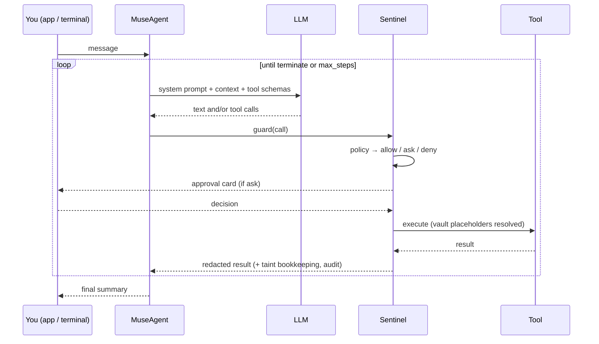

# 架构

本文说明各项行为对应哪些源码文件。修改智能体循环、添加工具或调整哨兵（Sentinel）相关行为前，请先阅读。

> 术语说明：LLM 是生成回答并提出工具调用的大语言模型；运行时是执行智能体和工具的程序；上下文是一次调用模型时提供的指令、对话与工具结果；审批是由用户确认是否允许操作。

## 一轮任务的流程 {#one-turn}



`MuseAgent.run()` 在每轮开始时组装一次系统提示词，包括配置档案、语言规则、相关记忆和进行中的目标。随后反复调用模型，将模型提出的每个工具调用交给 `Sentinel.guard()` 检查，并把结果追加到对话中。模型调用 `terminate`，或直接给出不带工具调用的回答时，本轮结束。App 在任务执行期间发来的新消息，会在下一次模型调用前加入上下文。如果同一调用反复出现却没有进展，系统会触发停滞检测；达到 `max_steps` 后则强制收尾。

## 源码与职责 {#source-map}

| 区域 | 文件 | 说明 |
|---|---|---|
| 组件组装入口 | `nanomuse/app.py` | `NanoMuseApp` 根据设置组装 LLM、工具、保险库、哨兵、记忆、目标和智能体 |
| 智能体循环 | `nanomuse/agent/core.py` | 组装提示词、裁剪上下文、检测停滞、持久保存会话、接收中途消息；可选共享[任务预算](runtime-budgets.md)，缩短工具结果时记录日志 |
| 提示词 | `nanomuse/prompts.py` | 系统提示词、语言规则、文字系统检测，以及推进目标的提示词 |
| 哨兵 | `nanomuse/sentinel/gate.py`、`policy.py`、`audit.py`、`review.py` | 工具调用检查、决策顺序、审批、污染状态、保险库占位符解析、脱敏和 JSONL 审计日志；可选的后台模型观察不改变执行权限 |
| 保险库 | `nanomuse/vault/vault.py` | Fernet 加密存储，以及 `{{vault:NAME}}` 机密占位符 |
| 工具基类 | `nanomuse/tools/base.py` | `BaseTool`、`CallAssessment`、`ToolCollection`、`safe_execute` |
| 内置工具 | `nanomuse/tools/files.py`、`shell.py`、`web.py`、`email_tool.py`、`browser.py` + `browser_backends.py`，支持服务器 Playwright 或手机 WebView，见 [browser.md](browser.md)；`memory_tools.py`、`goal_tools.py`、`terminate.py` | |
| MCP 工具协议 | `nanomuse/tools/mcp_tools.py` | 提供 stdio、streamable HTTP 和 SSE 客户端，分别通过标准输入输出、可流式 HTTP 和服务器事件推送通信；每个远程工具对应一个 `MCPTool`；`MCPServerSettings.tools` 可覆盖单个工具风险配置 |
| 手机上的运行环境 | `nanomuse/runtime.py`、`nanomuse/bridge/` | `device()` 读取 `NANOMUSE_DEVICE*`；`DEVICE_TOOLS` 定义手机工具的哨兵默认规则；`device_mcp_server()` 将 App MCP 服务器注册为 `device`，工具名为 `device__*`；`/api/bridge/*` 提供每条命令单独授权的令牌，支持 `nanomuse-device` / `nanomuse-browser` / `nanomuse-open` 命令行桥接，见 [device.md](device.md)、[local-runtime.md](local-runtime.md) |
| 手机屏幕操作 | `nanomuse/phone/link.py`、`screen.py`、`operator.py`、`trace.py`、`nanomuse/tools/phone.py` | 管理连接设备，通过 App WebSocket 双向连接收发请求；以截图加说明表示屏幕；操作器使用独立模型运行循环，采用 MemGUI `mobile_use` 格式、999 网格坐标；生成 JSONL 轨迹及 HTML 查看页面；实现 `phone_screen` / `phone_act` / `phone_task` 及其哨兵评估，见 [gui.md](gui.md) |
| LLM | `nanomuse/llm/base.py`、`openai_chat.py`、`openai_responses.py`、`prompt_tools.py`、`factory.py`、`mock.py`；`catalogue.py` + `providers.json`、`chatgpt.py`、`codex.py`、`chatgpt_proxy.py` | `BaseLLM` 接口、过滤 `<think>` 的流式输出、重试、基于提示词的工具调用、测试用 `MockLLM`；服务商目录记录对话、视觉、图像和视频能力；ChatGPT 登录使用 PKCE 授权校验和令牌存储；`provider = "chatgpt"` 与 `nanomuse chatgpt proxy` 负责 Chat Completions ↔ Codex Responses 转换 |
| 记忆与目标 | `nanomuse/memory/store.py`、`nanomuse/memory/consolidate.py`、`nanomuse/goals/store.py` | 使用 SQLite；关键词和语义检索查询全部存储，不受列表接口默认 1,000 行限制；数据库变更前复用关键词索引，包括编辑、遗忘、恢复及其他连接写入造成的变更；注入记忆时按 IDF，即罕见词权重排序，支持各类字母文字，并将中日韩文本拆为相邻双字；整理计划及检查会拒绝无法判断的合并；变更日志支持撤销 |
| App 服务器 | `nanomuse/server/service.py`、`outbox.py`、`api.py`、`webui.py`、`events.py` | 对话线程和工作任务管理；持久保存定时任务交接，保证至少交付一次；REST 请求接口和 WebSocket 双向连接；将回调转换为事件的 `UI` 实现；持久保存时间线 |
| 前端 | `web/src/` | React + TypeScript + Tailwind；`store.tsx` 管理状态及 WebSocket，`screens/` 实现标签页，`components/` 提供卡片、形象和 Markdown 组件 |
| 终端 | `nanomuse/console.py`、`nanomuse/cli.py` | 使用 Rich 构建控制台界面并在其中处理审批；使用 Typer 提供命令 |
| 配置与数据结构 | `nanomuse/config.py`、`nanomuse/schema.py` | Pydantic 设置，以及消息和工具调用的数据模型 |

发送 Responses API 请求前，Python 运行时的 `openai_responses`、`codex.py` 中的 Codex Responses 转换，以及 Android、iOS 的序列化器，都会保证本次请求中的 `function_call.call_id` 唯一，并对配对的 `function_call_output` 使用相同的新 ID。序列化器负责把程序对象转换为请求数据。这种改写只作用于本次请求，推理条目的 ID 保持不变。

## `UI` 协议 {#the-ui-protocol}

任何向用户展示智能体的界面，都需要实现 `nanomuse/ui.py::UI`。协议包括增量文字、助手消息、工具调用及结果、哨兵通知、`ask_approval()` 和 `ask_user()`。`ConsoleUI` 是终端实现；`WebUI` 将同样的回调转为时间线事件和 WebSocket 消息，并用 future（等待异步结果的对象）暂存审批，直到 App 回答。Telegram 或其他桌面前端也可以实现该协议，或直接作为 HTTP API 客户端连接。

## App 中的对话线程 {#threads-in-the-app}

`MuseService` 为每个对话线程保留一个 `MuseAgent`。每个线程有独立对话和后台执行任务，共享记忆库、目标库、保险库和审计日志。主线程对应长期使用的「主要聊天」，旁聊各自使用独立线程；后台目标检查也在单独线程运行，再向主要聊天发送摘要。`contextvar` 用于告诉 `WebUI` 当前回调属于哪个线程。

时间线写入会合并处理，并通过版本号区分先后。关闭时会写入最新快照，较早工作任务的写入不能在之后覆盖它。模型对话历史先写到目标旁的临时文件，再通过原子替换更新，也就是整份文件一次替换；如果写入失败，之前有效的 JSON 文件仍然保留。

## 扩展方式 {#extension-points}

| 要添加什么 | 实现方式 |
|---|---|
| 工具 | 在 `nanomuse/tools/` 继承 `BaseTool`，声明 `risk`；某些调用比默认风险高时重写 `assess()`；在 `app.py::_build_tools` 注册，并添加使用 `MockLLM` 的测试 |
| 连接器 | 优先使用 MCP 服务器，即 `[[mcp.servers]]`；协议不适合时再编写工具 |
| 模型服务商 | 多数接口可直接使用 `openai` / `openai_responses`；否则实现 `BaseLLM`，并在 `llm/factory.py` 中注册 |
| 前端 | 实现 `UI`，或按照 `docs/app.md` 调用 HTTP/WebSocket API |
| 哨兵行为 | 决策逻辑修改 `policy.py`，执行前后的处理修改 `gate.py` |

## 测试 {#tests}

```bash
python -m pytest -q                 # unit tests with MockLLM, no network
NANOMUSE_LIVE=1 python -m pytest -q -m live    # smoke test against your configured model
ruff check nanomuse tests && ruff format --check nanomuse tests
cd web && npm run build             # type-checks and rebuilds the app
```

`tests/test_server.py` 使用预设响应的 `MockLLM` 对 App 服务器进行端到端测试，覆盖发消息、审批卡片、提问、目标、记忆、文件和设置。

[GUI 回归](gui-regression.md)说明固定模拟任务、独立状态检查，以及参考实现和真实模型的测试入口。它的用量记录功能不要求启用任务预算。

[目标评测任务](goal-eval.md)介绍十条已录制任务轨迹，以及需主动启用的模型测试。
